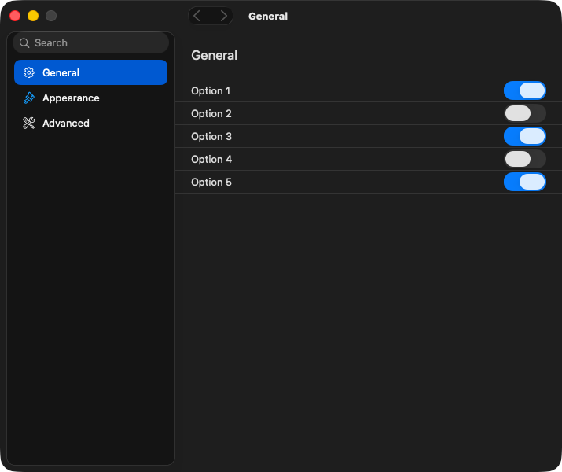
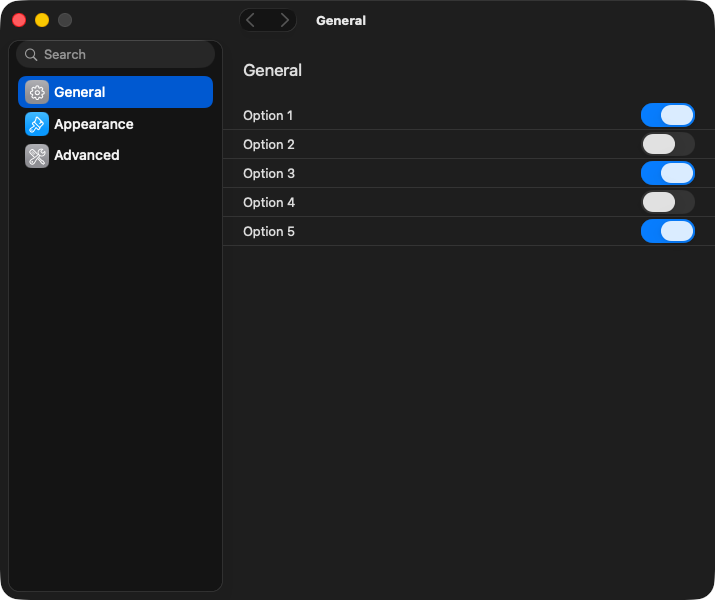

English | [简体中文](README.zh-Hans.md)

# SidebarSettingsKit

A settings window for a macOS SwiftUI app, laid out like System Settings: a sidebar of pages that
never collapses, a search field above it, the selected page beside it, and back and forward in the
toolbar. The icons are drawn as the system sidebar draws them, or on colored tiles as in System
Settings.


[](https://github.com/chengzi-io/SidebarSettingsKit/actions/workflows/ci.yml)

<p align="center">
  
  
</p>
<p align="center">
  
  
</p>

## Add it with an AI agent

```sh
npx skills add chengzi-io/SidebarSettingsKit
```

The [skills CLI](https://github.com/vercel-labs/skills) installs the repo's agent skill into the
project for Claude Code, Codex, Cursor and the other agents it knows; `-g` installs it for every
project. Then ask the agent to give the app sidebar settings: the skill reads the project, picks
pages and their icons, adds the dependency, moves an existing `Settings` scene over and checks the
result. An agent without the CLI can follow
[`skills/sidebar-settings-kit/SKILL.md`](skills/sidebar-settings-kit/SKILL.md) directly.

## Why

| What you want | SwiftUI's `Settings` scene | SwiftUI's `NavigationSplitView` | SidebarSettingsKit |
| --- | --- | --- | --- |
| A settings window whose toolbar you control | keeps the preferences toolbar; no back or forward, no items of yours | a normal window, whose ⌘, item you add by hand; not the app's settings window | an `NSWindow` with a toolbar the kit fills |
| A sidebar that stays put | has no sidebar | collapses when its divider is dragged in, and nothing brings it back | a fixed-width sidebar that cannot collapse |
| A search field above the pages | has none | `.searchable` puts the field in the toolbar | fixed above the list; ⌘F focuses it, ↓ moves to the pages found, Esc clears it |

## Features

| Feature | Default |
| --- | --- |
| Sidebar of pages, grouped | one ungrouped list |
| Search field above the pages, matching titles and keywords | on |
| Back and forward, with a browser-like history | on: ⌘[ and ⌘] |
| Sidebar header (scrolls with the pages) and footer (stays) | none |
| Icons plain or on colored tiles | plain |
| Sidebar width | 215 pt, fixed |
| Window | 715 × 600, fixed size, position saved |
| Title | follows the selected page |
| Line under the toolbar | shows while the page is scrolled |
| Page, history and search when the window reopens | kept while the app runs |
| Pages scroll inside the window | on |
| The kit's own words | every language macOS has, in the app's language |

## Quick start

### Install

SwiftPM manifest:

```swift
dependencies: [
    .package(url: "https://github.com/chengzi-io/SidebarSettingsKit.git", .upToNextMinor(from: "0.1.0"))
],
targets: [
    .target(
        name: "MyApp",
        dependencies: [
            .product(name: "SidebarSettingsKit", package: "SidebarSettingsKit")
        ]
    )
]
```

While the kit is 0.x, a minor release may break the API, hence `.upToNextMinor`.

In Xcode: File > Add Package Dependencies…, paste
`https://github.com/chengzi-io/SidebarSettingsKit.git`, choose "Up to Next Minor Version" from
0.1.0, and add the `SidebarSettingsKit` library to the app target.

### Use

One page type, one window, one menu item. `ContentView`, `GeneralSettings` and `AdvancedSettings`
stand for the app's own views.

```swift
import SidebarSettingsKit
import SwiftUI

enum Pane: String, CaseIterable, SettingsPage {
    case general, advanced

    var id: Self { self }

    var title: LocalizedStringResource {
        switch self {
        case .general: "General"
        case .advanced: "Advanced"
        }
    }

    var icon: SettingsIcon {
        switch self {
        case .general: .system("gearshape")
        case .advanced: .system("wrench.and.screwdriver")
        }
    }
}

@main
struct MyApp: App {
    private let settings = SidebarSettingsWindow(pages: Pane.allCases) { pane in
        switch pane {
        case .general: GeneralSettings()
        case .advanced: AdvancedSettings()
        }
    }

    var body: some Scene {
        WindowGroup { ContentView() }
            .commands { SidebarSettingsCommands(window: settings) }
    }
}
```

Delete the app's `Settings` scene: `SidebarSettingsCommands` replaces its "Settings…" item and
⌘, and keeping both gives two items.

Write each page as a grouped `Form` (`.formStyle(.grouped)`), as System Settings' pages are. A
page scrolls itself; the window adds no scroll view, and the line under the toolbar follows the
form. A page that is neither a form nor a list and can grow taller than the window goes in a
`ScrollView`.

The scene's environment does not reach this window, so pass pages their models in the `detail`
closure. `SettingsLink` and `openSettings` do not open it either; use `settings.show()` or
`SidebarSettingsCommands`.

## Groups, header and footer

```swift
let settings = SidebarSettingsWindow(
    sections: [
        SettingsPageSection(pages: [Pane.general]),
        SettingsPageSection(pages: [Pane.advanced]),
    ],
    header: { AccountRow() },
    footer: { Text("Version 1.0").font(.caption).foregroundStyle(.secondary).padding(8) }
) { pane in
    switch pane {
    case .general: GeneralSettings()
    case .advanced: AdvancedSettings()
    }
}
```

Groups are set apart by space, as System Settings' are; an empty group is left out. The header
is the list's first item and scrolls with the pages; the footer stays at the bottom.

## Icons

```swift
var configuration = SidebarSettingsConfiguration()
configuration.icons = .tiled

let settings = SidebarSettingsWindow(pages: Pane.allCases, configuration: configuration) { pane in
    switch pane {
    case .general: GeneralSettings()
    case .advanced: AdvancedSettings()
    }
}
```

`.plain`, the default, draws each icon as the system sidebar does, in its tint, and white with
the title on the selected row. `.tiled` draws it in white on a colored rounded square, as System
Settings does. The square takes the page's tint (`.system("paintpalette", tint: .blue)`); a page
without one gets gray, or the color in `.tiled(defaultColor: .indigo)`. An icon that is your own
view (`.custom`) is drawn as it is either way.

Every icon fills the sidebar's icon slot, so like System Settings' it follows the Sidebar icon
size setting (16, 20 or 24 pt), and the rows keep the system's height and text. Either way the
sidebar is the system's sidebar list: selection, arrow keys, type-to-select and VoiceOver work as
in any Mac sidebar, and on macOS 26 and later it keeps Liquid Glass.

## Configuration

```swift
var configuration = SidebarSettingsConfiguration()
configuration.resizing = .resizable(min: CGSize(width: 640, height: 420))
configuration.title = .fixed("Settings")

let settings = SidebarSettingsWindow(pages: Pane.allCases, configuration: configuration) { pane in
    switch pane {
    case .general: GeneralSettings()
    case .advanced: AdvancedSettings()
    }
}
```

| Field | Default | Alternatives |
| --- | --- | --- |
| `size` | 715 × 600 | any `CGSize` |
| `resizing` | `.fixed` | `.resizable(min:max:)`, either limit `nil` |
| `autosaveName` | `"SidebarSettingsWindow"` | any name; `nil` saves no position |
| `sidebarWidth` | `.fixed(215)` | `.adjustable(min:ideal:max:)` |
| `toolbarStyle` | `.automatic` | `.unifiedCompact`, `.unified` |
| `showsNavigationButtons` | `true` | `false`, which also drops ⌘[ and ⌘] |
| `title` | `.followsPage` | `.fixed(_:)`, `.hidden` |
| `toolbarSeparator` | `.whenScrolled` | `.always`, `.never` |
| `search` | `.enabled` | `.disabled` |
| `navigationPersistence` | `.session` | `.resetOnShow` |
| `strings` | `Strings.default` | `Strings(back:forward:searchPrompt:settingsMenuItem:noSearchResults:)` |
| `icons` | `.plain` | `.tiled`, `.tiled(defaultColor:)` |

The configuration is fixed when the window object is created. Whatever it says, the minimize and
zoom buttons are dimmed and the window cannot go full screen, as Apple's guidelines ask of a
settings window; a resizable window resizes from its edges.

## Light and dark

The window follows the app's appearance, as the app's other windows do: the Mac's setting, unless
the app picks one. An app with its own Light, Dark and System choice applies it to the whole app
through AppKit:

```swift
NSApp.appearance = switch choice {
case .system: nil
case .light: NSAppearance(named: .aqua)
case .dark: NSAppearance(named: .darkAqua)
}
```

SwiftUI's `.preferredColorScheme` does not reach the settings window, even from inside a page.

## Languages

The kit owns five pieces of text: Back, Forward, Search, Settings… and No Results, which the
sidebar shows when a search finds no page. It ships them in every language macOS has, in the
words macOS uses for the same controls, and shows them in the language the app runs in, as
AppKit does its menus:

| The app | The kit's words |
| --- | --- |
| declares languages (`CFBundleLocalizations` or `<language>.lproj` folders in the app bundle) and runs in one | that language |
| declares no language (a bare `swift run` executable, or an app bundle without the entry) | English, whatever the Mac's language |

An app whose text is written in one language without localization runs in English as far as the
kit can tell, so it passes its own words; so does an app that wants other words, such as
Preferences… for Settings…:

```swift
configuration.strings = .init(
    back: "戻る", forward: "進む", searchPrompt: "検索", settingsMenuItem: "設定…",
    noSearchResults: "結果なし")
```

A word given as a key follows the app's language like the rest of its text, from the string
catalog that holds the key. A key without a bundle is looked up in the app's main bundle, where an
app target's catalog goes. A Swift package module keeps its resources in a bundle of its own, so
a key from a module's catalog names it, or the key is not found and its default value shows:

```swift
configuration.strings = .init(
    back: LocalizedStringResource("Back", bundle: .atURL(Bundle.module.bundleURL)))
```

The window reads the language once, when it is built. Changing the app's language in System
Settings relaunches the app, so everything follows. An app that switches language without a
relaunch, through `.environment(\.locale, …)`, reaches only the pages, and only if it applies the
locale inside `detail`: the sidebar's titles, the window title and the kit's words keep the
launch language until the app relaunches.

## Open on a page

```swift
@MainActor
func openAdvanced(_ settings: SidebarSettingsWindow<Pane>) {
    settings.show(page: .advanced)
}
```

`show(page:)` activates the app and brings the window forward, which a menu bar app needs.

## Menu bar apps

```swift
struct MenuBarSettingsApp: App {
    private let settings = SidebarSettingsWindow(pages: Pane.allCases) { pane in
        switch pane {
        case .general: GeneralSettings()
        case .advanced: AdvancedSettings()
        }
    }

    var body: some Scene {
        MenuBarExtra("MyApp", systemImage: "bolt") {
            OpenSidebarSettingsButton(window: settings)
            Button("Quit MyApp") { NSApp.terminate(nil) }
        }
    }
}
```

`OpenSidebarSettingsButton` opens the window on any page, with the kit's word for the menu item
("Settings…") or a label of yours. A `Settings` scene kept only to give the app a scene can go.

## Requirements

| | |
| --- | --- |
| To run an app using the kit | macOS 14 or later |
| To build it | Xcode 26 or later, with Swift 6.2 or later (the manifest is `swift-tools-version: 6.2`) |
| Dependencies | none |

## Known limits

- On macOS 14 the line under the toolbar always shows: SwiftUI there cannot report the page's
  scroll position.
- On macOS 14 and 15 the toolbar takes its background from the scroll view under it. Above a form
  or a list it matches the page; above a plain `ScrollView` it keeps a lighter background of its
  own.
- A window's pages and configuration are fixed at creation; to change them, close it and create
  another one.

Planned work is in [docs/ROADMAP.md](docs/ROADMAP.md).

## Documentation

| File | Covers |
| --- | --- |
| [docs/ARCHITECTURE.md](docs/ARCHITECTURE.md) | how the window is built and why |
| [docs/DEVELOPMENT.md](docs/DEVELOPMENT.md) | the demo, screenshots, CI, releasing |
| [docs/TESTING.md](docs/TESTING.md) | the test targets, fixtures, window tests and the false-pass rule |
| [docs/MANUAL-QA.md](docs/MANUAL-QA.md) | the checks a maintainer makes before a release |
| [docs/ROADMAP.md](docs/ROADMAP.md) | planned work and known limits |
| [CHANGELOG.md](CHANGELOG.md) | changes per version |

## Contributing

Read [docs/DEVELOPMENT.md](docs/DEVELOPMENT.md) for the daily loop and [docs/MANUAL-QA.md](docs/MANUAL-QA.md)
for the release checks. `make ci` must pass before a pull request is ready.

## License

MIT. See [LICENSE](LICENSE).
