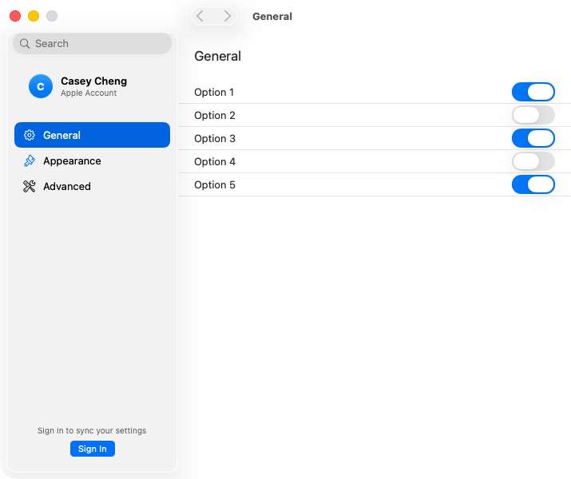
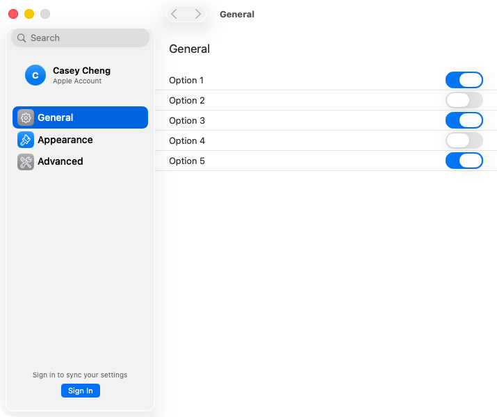

English | [简体中文](README.zh-Hans.md)

# SidebarSettingsKit

A settings window for a macOS SwiftUI app, laid out like System Settings: a sidebar of pages that
never collapses, a search field above it, the selected page beside it, and back and forward in the
toolbar. Two looks: the system sidebar, or a branded one with icons on colored tiles.


[](https://github.com/chengzi-io/SidebarSettingsKit/actions/workflows/ci.yml)

<p align="center">
  
  
</p>
<p align="center">
  
  
</p>

## Why

| What you want | SwiftUI's `Settings` scene | SwiftUI's `NavigationSplitView` | SidebarSettingsKit |
| --- | --- | --- | --- |
| A settings window whose toolbar you control | keeps the preferences toolbar; no back or forward, no items of yours | a normal window, whose ⌘, item you add by hand; not the app's settings window | an `NSWindow` with a toolbar the kit fills |
| A sidebar that stays put | has no sidebar | collapses when its divider is dragged in, and nothing brings it back | a fixed-width sidebar that cannot collapse |
| A search field above the pages | has none | `.searchable` puts the field in the toolbar | fixed above the list; ⌘F focuses it, Esc clears it |

## Features

| Feature | Default |
| --- | --- |
| Sidebar of pages, grouped | one ungrouped list |
| Search field above the pages, matching titles and keywords | on |
| Back and forward, with a browser-like history | on: ⌘[ and ⌘] |
| Sidebar header (scrolls with the pages) and footer (stays) | none |
| Two looks: `.native`, `.branded` | `.native` |
| Sidebar width | 215 pt, fixed |
| Window | 715 × 600, fixed size, position saved |
| Title | follows the selected page |
| Line under the toolbar | shows while the page is scrolled |
| Page, history and search when the window reopens | kept while the app runs |
| Pages scroll inside the window | on |
| The kit's own words | English and Simplified Chinese, in the app's language |

## Quick start

### Install

SwiftPM manifest:

```swift
dependencies: [
    .package(url: "https://github.com/chengzi-io/SidebarSettingsKit.git", .upToNextMinor(from: "0.1.0"))
],
targets: [
    .target(
        name: "MyApp",
        dependencies: [
            .product(name: "SidebarSettingsKit", package: "SidebarSettingsKit")
        ]
    )
]
```

While the kit is 0.x, a minor release may break the API, hence `.upToNextMinor`.

In Xcode: File > Add Package Dependencies…, paste
`https://github.com/chengzi-io/SidebarSettingsKit.git`, choose "Up to Next Minor Version" from
0.1.0, and add the `SidebarSettingsKit` library to the app target.

### Use

One page type, one window, one menu item. `ContentView`, `GeneralSettings` and `AdvancedSettings`
stand for the app's own views.

```swift
import SidebarSettingsKit
import SwiftUI

enum Pane: String, CaseIterable, SettingsPage {
    case general, advanced

    var id: Self { self }

    var title: LocalizedStringResource {
        switch self {
        case .general: "General"
        case .advanced: "Advanced"
        }
    }

    var icon: SettingsIcon {
        switch self {
        case .general: .system("gearshape")
        case .advanced: .system("wrench.and.screwdriver")
        }
    }
}

@main
struct MyApp: App {
    private let settings = SidebarSettingsWindow(pages: Pane.allCases) { pane in
        switch pane {
        case .general: GeneralSettings()
        case .advanced: AdvancedSettings()
        }
    }

    var body: some Scene {
        WindowGroup { ContentView() }
            .commands { SidebarSettingsCommands(window: settings) }
    }
}
```

Delete the app's `Settings` scene: `SidebarSettingsCommands` replaces its "Settings…" item and
⌘, and keeping both gives two items.

The scene's environment does not reach this window, so pass pages their models in the `detail`
closure. `SettingsLink` and `openSettings` do not open it either; use `settings.show()` or
`SidebarSettingsCommands`.

## Groups, header and footer

```swift
let settings = SidebarSettingsWindow(
    sections: [
        SettingsPageSection(pages: [Pane.general]),
        SettingsPageSection("Advanced", pages: [Pane.advanced]),
    ],
    header: { AccountRow() },
    footer: { Text("Version 1.0").font(.caption).foregroundStyle(.secondary).padding(8) }
) { pane in
    switch pane {
    case .general: GeneralSettings()
    case .advanced: AdvancedSettings()
    }
}
```

A group with a title shows it above its rows, as Finder's sidebar does; a group without one is set
apart by space alone, as System Settings does. An empty group is left out. The header is the
list's first item and scrolls with the pages; the footer stays at the bottom.

## Styles

```swift
var style = SidebarSettingsStyle.branded
style.iconTile = .init(size: 28, cornerRadius: 7, defaultColor: .indigo)

let settings = SidebarSettingsWindow(pages: Pane.allCases, style: style) { pane in
    switch pane {
    case .general: GeneralSettings()
    case .advanced: AdvancedSettings()
    }
}
```

`.native` is the system sidebar, untouched. `.branded` is for an app with a brand: 24 pt colored tiles
behind the icons, rows as tall as the tiles need, and 14 pt medium text. Both are the system's
sidebar list, so selection, arrow keys, type-to-select and VoiceOver work as in any Mac sidebar.
A style is a value, so copying a preset and changing a token leaves the preset alone. No preset
changes the sidebar's material, so on macOS 26 it keeps Liquid Glass.

Give each page a tint for its tile (`.system("paintpalette", tint: .blue)`); without one the tile
uses its `defaultColor`.

## Configuration

```swift
var configuration = SidebarSettingsConfiguration()
configuration.resizing = .resizable(min: CGSize(width: 640, height: 420))
configuration.title = .fixed("Settings")

let settings = SidebarSettingsWindow(pages: Pane.allCases, configuration: configuration) { pane in
    switch pane {
    case .general: GeneralSettings()
    case .advanced: AdvancedSettings()
    }
}
```

| Field | Default | Alternatives |
| --- | --- | --- |
| `size` | 715 × 600 | any `CGSize` |
| `resizing` | `.fixed` | `.resizable(min:max:)`, either limit `nil` |
| `autosaveName` | `"SidebarSettingsWindow"` | any name; `nil` saves no position |
| `sidebarWidth` | `.fixed(215)` | `.adjustable(min:ideal:max:)` |
| `toolbarStyle` | `.unifiedCompact` | `.unified`, `.automatic` |
| `showsNavigationButtons` | `true` | `false`, which also drops ⌘[ and ⌘] |
| `title` | `.followsPage` | `.fixed(_:)`, `.hidden` |
| `toolbarSeparator` | `.whenScrolled` | `.always`, `.never` |
| `search` | `.enabled` | `.disabled` |
| `navigationPersistence` | `.session` | `.resetOnShow` |
| `detailScrolling` | `true` | `false`, for pages that scroll themselves |
| `strings` | `Strings.default` | `Strings(back:forward:searchPrompt:settingsMenuItem:)` |

The configuration is fixed when the window object is created.

## Languages

The kit owns four words: Back, Forward, Search and Settings…. It ships them in English and
Simplified Chinese and shows them in the language the app runs in, as AppKit does its menus:

| The app | The kit's words |
| --- | --- |
| declares Simplified Chinese (`CFBundleLocalizations` or a `zh-Hans.lproj` in the app bundle) and runs in it | Chinese |
| runs in English, or in a language the kit does not ship | English |
| declares no language (a bare `swift run` executable, or an app bundle without the entry) | English, whatever the Mac's language |

An app in another language, or whose text is written in one language without localization,
passes its own words:

```swift
configuration.strings = .init(back: "戻る", forward: "進む", searchPrompt: "検索", settingsMenuItem: "設定…")
```

A word given as a key the app's string catalog translates follows the app's language like the
rest of its text.

The window reads the language once, when it is built. Changing the app's language in System
Settings relaunches the app, so everything follows. An app that switches language without a
relaunch, through `.environment(\.locale, …)`, reaches only the pages, and only if it applies the
locale inside `detail`: the sidebar's titles, the window title and the kit's words keep the
launch language until the app relaunches.

## Open on a page

```swift
@MainActor
func openAdvanced(_ settings: SidebarSettingsWindow<Pane>) {
    settings.show(page: .advanced)
}
```

`show(page:)` activates the app and brings the window forward, which a menu bar app needs.

## Menu bar apps

```swift
struct MenuBarSettingsApp: App {
    private let settings = SidebarSettingsWindow(pages: Pane.allCases) { pane in
        switch pane {
        case .general: GeneralSettings()
        case .advanced: AdvancedSettings()
        }
    }

    var body: some Scene {
        MenuBarExtra("MyApp", systemImage: "bolt") {
            OpenSidebarSettingsButton(window: settings)
            Button("Quit MyApp") { NSApp.terminate(nil) }
        }
    }
}
```

`OpenSidebarSettingsButton` opens the window on any page, with the kit's word for the menu item
("Settings…") or a label of yours. A `Settings` scene kept only to give the app a scene can go.

## Use it with an AI agent

The repo ships an agent skill, `skills/sidebar-settings-kit/`: it reads a project, picks pages and
a style, adds the dependency and moves an existing `Settings` scene over.

- Claude Code: copy the folder to `.claude/skills/sidebar-settings-kit/` in the project, or to
  `~/.claude/skills/` for every project.
- Other agents: point them at `skills/sidebar-settings-kit/SKILL.md`, which links its reference
  files (`references/integration.md`, `configuration.md`, `styling.md`).

## Requirements

| | |
| --- | --- |
| To run an app using the kit | macOS 14 or later |
| To build it | Xcode 26 with Swift 6.2 (the manifest is `swift-tools-version: 6.2`) |
| Dependencies | none |

## Known limits

- On macOS 14 the line under the toolbar always shows: SwiftUI there cannot report the page's
  scroll position.
- `configuration.detailScrolling` applies to every page of a window, not one page.
- A window's pages and configuration are fixed at creation; to change them, close it and create
  another one.

Planned work is in [docs/ROADMAP.md](docs/ROADMAP.md).

## Documentation

| File | Covers |
| --- | --- |
| [docs/ARCHITECTURE.md](docs/ARCHITECTURE.md) | how the window is built and why |
| [docs/DEVELOPMENT.md](docs/DEVELOPMENT.md) | the demo, screenshots, CI, releasing |
| [docs/TESTING.md](docs/TESTING.md) | the test targets, fixtures, window tests and the false-pass rule |
| [docs/MANUAL-QA.md](docs/MANUAL-QA.md) | the checks a maintainer makes before a release |
| [docs/ROADMAP.md](docs/ROADMAP.md) | planned work and known limits |
| [CHANGELOG.md](CHANGELOG.md) | changes per version |

## Contributing

Read [docs/DEVELOPMENT.md](docs/DEVELOPMENT.md) for the daily loop and [docs/MANUAL-QA.md](docs/MANUAL-QA.md)
for the release checks. `make ci` must pass before a pull request is ready.

## License

MIT. See [LICENSE](LICENSE).
