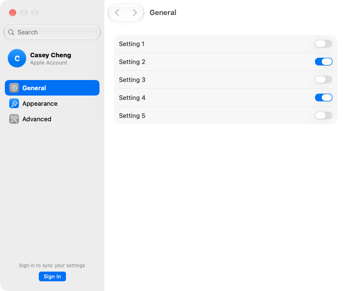

[English](README.md) | 简体中文

# SidebarSettingsKit

一个给 macOS SwiftUI 应用用的设置窗口，版式与系统设置一致：侧边栏里是从不折叠的页面，上方是搜索框，旁边是选中的页面，工具栏里有后退和前进。图标按系统侧边栏的画法绘制，或者像系统设置那样放在彩色方块上。


[](https://github.com/chengzi-io/SidebarSettingsKit/actions/workflows/ci.yml)

<p align="center">
  
  
  
</p>
<p align="center"><sub>依次为 macOS 15、macOS 26、macOS 27</sub></p>

## 让 AI agent 来添加

```sh
npx skills add chengzi-io/SidebarSettingsKit
```

[skills CLI](https://github.com/vercel-labs/skills) 会把仓库里的 agent skill 装进项目，供 Claude Code、Codex、Cursor 以及它认识的其他 agent 使用；`-g` 表示装到所有项目。然后让 agent 给应用加上侧边栏式设置：这个 skill 会读项目、挑页面和图标、添加依赖、把已有的 `Settings` scene 迁移过来，并检查结果。没有这个 CLI 的 agent 可以直接照 [`skills/sidebar-settings-kit/SKILL.md`](skills/sidebar-settings-kit/SKILL.md) 做。

## 为什么

| 你想要 | SwiftUI 的 `Settings` scene | SwiftUI 的 `NavigationSplitView` | SidebarSettingsKit |
| --- | --- | --- | --- |
| 一个工具栏由自己掌控的设置窗口 | 保留偏好设置的工具栏：没有后退和前进，也放不进自己的工具栏条目 | 普通窗口，⌘, 条目得自己加；不是应用的设置窗口 | 一个 `NSWindow`，工具栏由套件填充 |
| 一个不动的侧边栏 | 没有侧边栏 | 分隔条往里一拖就折叠，而且没有办法把它找回来 | 固定宽度、无法折叠的侧边栏 |
| 页面之上的搜索框 | 没有 | `.searchable` 会把搜索框放进工具栏 | 固定在列表上方；⌘F 聚焦，↓ 跳到搜到的页面，Esc 清空 |

## 功能

| 功能 | 默认 |
| --- | --- |
| 分组的页面侧边栏 | 一个不分组列表 |
| 页面之上的搜索框，匹配标题和关键词 | 开启 |
| 后退和前进，带类似浏览器的历史记录 | 开启：⌘[ 和 ⌘] |
| 侧边栏头部（随页面滚动）和底部（固定不动） | 没有 |
| 图标为纯色，或放在彩色方块上 | 纯色 |
| 侧边栏宽度 | 215 pt，固定 |
| 窗口 | 715 × 600，固定尺寸，保存位置 |
| 标题 | 跟随选中的页面 |
| 工具栏下方的分隔线 | 与每个 macOS 版本上的系统设置一致（macOS 14 上始终显示） |
| 窗口重新打开时的页面、历史记录和搜索 | 应用运行期间保留 |
| 套件自带的文字 | macOS 支持的每种语言，按应用的语言显示 |

## 快速开始

### 安装

SwiftPM 清单：

```swift
dependencies: [
    .package(url: "https://github.com/chengzi-io/SidebarSettingsKit.git", .upToNextMinor(from: "0.1.0"))
],
targets: [
    .target(
        name: "MyApp",
        dependencies: [
            .product(name: "SidebarSettingsKit", package: "SidebarSettingsKit")
        ]
    )
]
```

套件还在 0.x，次版本发布就可能破坏 API，所以用 `.upToNextMinor`。

在 Xcode 里：File > Add Package Dependencies…，粘贴
`https://github.com/chengzi-io/SidebarSettingsKit.git`，从 0.1.0 起选 “Up to Next Minor Version”，
再把 `SidebarSettingsKit` 库加到应用 target 上。

### 使用

一个页面类型、一个窗口、一个菜单项。`ContentView`、`GeneralSettings` 和 `AdvancedSettings`
代表应用自己的视图。

```swift
import SidebarSettingsKit
import SwiftUI

enum Pane: String, CaseIterable, SettingsPage {
    case general, advanced

    var id: Self { self }

    var title: LocalizedStringResource {
        switch self {
        case .general: "General"
        case .advanced: "Advanced"
        }
    }

    var icon: SettingsIcon {
        switch self {
        case .general: .system("gearshape")
        case .advanced: .system("wrench.and.screwdriver")
        }
    }
}

@main
struct MyApp: App {
    private let settings = SidebarSettingsWindow(pages: Pane.allCases) { pane in
        switch pane {
        case .general: GeneralSettings()
        case .advanced: AdvancedSettings()
        }
    }

    var body: some Scene {
        WindowGroup { ContentView() }
            .commands { SidebarSettingsCommands(window: settings) }
    }
}
```

把应用自己的 `Settings` scene 删掉：`SidebarSettingsCommands` 会替换它的 “Settings…” 条目和
⌘,，两个都留着就会出现两个菜单项。

每个页面都写成分组的 `Form`（`.formStyle(.grouped)`），系统设置的页面就是这样。页面自己滚动，
窗口不会在它外面再套滚动视图。既不是表单也不是列表、又可能高过窗口的页面，放进 `ScrollView`。

scene 的环境不会传到这个窗口，所以在 `detail` 闭包里把模型传给页面。`SettingsLink` 和
`openSettings` 也打不开它；用 `settings.show()` 或 `SidebarSettingsCommands`。

## 分组、头部和底部

```swift
let settings = SidebarSettingsWindow(
    sections: [
        SettingsPageSection(pages: [Pane.general]),
        SettingsPageSection(pages: [Pane.advanced]),
    ],
    header: { AccountRow() },
    footer: { Text("Version 1.0").font(.caption).foregroundStyle(.secondary).padding(8) }
) { pane in
    switch pane {
    case .general: GeneralSettings()
    case .advanced: AdvancedSettings()
    }
}
```

分组之间靠间距分开，和系统设置一样；空的分组不会画出来。头部是列表的第一项，随页面一起滚动；
底部一直待在下面。

## 图标

```swift
var configuration = SidebarSettingsConfiguration()
configuration.icons = .tiled

let settings = SidebarSettingsWindow(pages: Pane.allCases, configuration: configuration) { pane in
    switch pane {
    case .general: GeneralSettings()
    case .advanced: AdvancedSettings()
    }
}
```

默认的 `.plain` 按系统侧边栏的画法绘制每个图标：用自己的色调，选中行上则和标题一起变白。`.tiled`
把它画成彩色圆角方块上的白色符号，和系统设置一样。方块取页面的色调（`.system("paintpalette", tint: .blue)`）；
页面没有色调就是灰色，或者用 `.tiled(defaultColor: .indigo)` 里的颜色。图标是你自己的视图（`.custom`）时，
两种样式都照原样绘制。

每个图标都填满侧边栏的图标槽位，所以跟系统设置一样，它会跟随用户的侧边栏图标大小设置（16、20 或 24 pt），
行也保持系统的高度和文字。两种样式下侧边栏都是系统的侧边栏列表：选中、方向键、按字选择（type-to-select）
和 VoiceOver 都像任何 Mac 侧边栏那样工作，macOS 26 及更高版本上还保留 Liquid Glass。

## 配置

```swift
var configuration = SidebarSettingsConfiguration()
configuration.resizing = .resizable(min: CGSize(width: 640, height: 420))
configuration.title = .fixed("Settings")

let settings = SidebarSettingsWindow(pages: Pane.allCases, configuration: configuration) { pane in
    switch pane {
    case .general: GeneralSettings()
    case .advanced: AdvancedSettings()
    }
}
```

| 字段 | 默认 | 其他取值 |
| --- | --- | --- |
| `size` | 715 × 600 | 任意 `CGSize` |
| `resizing` | `.fixed` | `.resizable(min:max:)`，任一边界可以是 `nil` |
| `autosaveName` | `"SidebarSettingsWindow"` | 任意名字；`nil` 表示不保存位置 |
| `sidebarWidth` | `.fixed(215)` | `.adjustable(min:ideal:max:)` |
| `toolbarStyle` | `.automatic` | `.unifiedCompact`（macOS 26 上自动）、`.unified` |
| `showsNavigationButtons` | `true` | `false`，同时去掉 ⌘[ 和 ⌘] |
| `title` | `.followsPage` | `.fixed(_:)`、`.hidden` |
| `search` | `.enabled` | `.disabled` |
| `navigationPersistence` | `.session` | `.resetOnShow` |
| `strings` | `Strings.default` | `Strings(back:forward:searchPrompt:settingsMenuItem:noSearchResults:)` |
| `icons` | `.plain` | `.tiled`、`.tiled(defaultColor:)` |

配置在创建窗口对象时就定死了。不管配置怎么写，最小化和缩放按钮都是置灰的，窗口也不能全屏，这是 Apple
对设置窗口的要求；可缩放的窗口从边缘拖动改变大小。

## 浅色与深色

窗口跟随应用的外观，和应用的其他窗口一样：Mac 的设置，除非应用自己指定。自带浅色、深色和跟随系统三项选择的应用，
通过 AppKit 把它应用到整个应用：

```swift
NSApp.appearance = switch choice {
case .system: nil
case .light: NSAppearance(named: .aqua)
case .dark: NSAppearance(named: .darkAqua)
}
```

SwiftUI 的 `.preferredColorScheme` 到不了设置窗口，即使从页面内部设置也不行。

## 语言

套件自带五段文字：Back、Forward、Search、Settings… 和 No Results（搜索没有任何结果时侧边栏显示的那句）。
这些文字按 macOS 支持的所有语言提供，用的就是 macOS 在同样控件上的措辞，并按应用运行的语言显示，AppKit
处理自己的菜单也是这样：

| 应用 | 套件显示的文字 |
| --- | --- |
| 声明了语言（`CFBundleLocalizations`，或应用包里有 `<language>.lproj` 目录）并在其中一种里运行 | 那种语言 |
| 没有声明语言（裸的 `swift run` 可执行文件，或应用包里没有这一项） | 英文，不管 Mac 是什么语言 |

文字只有一种语言、也没做本地化的应用，在套件看来就是在英文环境里运行，所以它传入自己的文字；想要别的措辞的应用
也一样，比如把 Settings… 换成 Preferences…：

```swift
configuration.strings = .init(
    back: "戻る", forward: "進む", searchPrompt: "検索", settingsMenuItem: "設定…",
    noSearchResults: "結果なし")
```

以 key 形式给出的文字和应用的其他文字一样跟随应用的语言，从持有该 key 的 string catalog 里取。没有 bundle 的 key
在应用的主 bundle 里查，应用 target 的 catalog 就在那里。Swift package 模块的资源放在自己的 bundle 里，所以来自
模块 catalog 的 key 要写明是哪个模块，否则找不到这个 key，显示的是它的默认值：

```swift
configuration.strings = .init(
    back: LocalizedStringResource("Back", bundle: .atURL(Bundle.module.bundleURL)))
```

窗口在构建时读一次语言。在系统设置里改应用的语言会重启应用，所以一切都跟着变。不重启就切换语言的应用
（用 `.environment(\.locale, …)`）只能影响到页面，而且还要在 `detail` 里应用 locale：侧边栏的标题、窗口标题
和套件自带的文字都会保持启动时的语言，直到应用重启。

## 打开到某一页

```swift
@MainActor
func openAdvanced(_ settings: SidebarSettingsWindow<Pane>) {
    settings.show(page: .advanced)
}
```

`show(page:)` 会激活应用并把窗口提到前面，菜单栏应用需要这样。

## 菜单栏应用

```swift
struct MenuBarSettingsApp: App {
    private let settings = SidebarSettingsWindow(pages: Pane.allCases) { pane in
        switch pane {
        case .general: GeneralSettings()
        case .advanced: AdvancedSettings()
        }
    }

    var body: some Scene {
        MenuBarExtra("MyApp", systemImage: "bolt") {
            OpenSidebarSettingsButton(window: settings)
            Button("Quit MyApp") { NSApp.terminate(nil) }
        }
    }
}
```

`OpenSidebarSettingsButton` 在任何页面上打开窗口，用套件自带的菜单项文字（“Settings…”）或你自己的标签。
只为给应用凑一个 scene 而留着的 `Settings` scene 可以删掉了。

## 要求

| | |
| --- | --- |
| 运行用到套件的应用 | macOS 14 或更高 |
| 构建 | Xcode 26 或更高，Swift 6.2 或更高（清单是 `swift-tools-version: 6.2`） |
| 依赖 | 无 |

## 已知限制

[docs/zh/ROADMAP.md](docs/zh/ROADMAP.md) 列出了套件目前有哪些限制，以及计划中的工作。

## 文档

| 文件 | 内容 |
| --- | --- |
| [docs/zh/ARCHITECTURE.md](docs/zh/ARCHITECTURE.md) | 窗口是怎么搭起来的，以及为什么 |
| [docs/zh/DEVELOPMENT.md](docs/zh/DEVELOPMENT.md) | 演示应用、截图、CI、发布 |
| [docs/zh/TESTING.md](docs/zh/TESTING.md) | 测试 target、fixtures、窗口测试和“假通过”规则 |
| [docs/zh/MANUAL-QA.md](docs/zh/MANUAL-QA.md) | 维护者发布前要做的检查 |
| [docs/zh/ROADMAP.md](docs/zh/ROADMAP.md) | 计划中的工作和已知限制 |
| [CHANGELOG.md](CHANGELOG.md) | 每个版本的变化 |

## 参与贡献

日常开发的流程见 [docs/zh/DEVELOPMENT.md](docs/zh/DEVELOPMENT.md)，发布前要做的检查见
[docs/zh/MANUAL-QA.md](docs/zh/MANUAL-QA.md)。提 pull request 之前 `make ci` 必须通过。

## 许可证

MIT。见 [LICENSE](LICENSE)。
