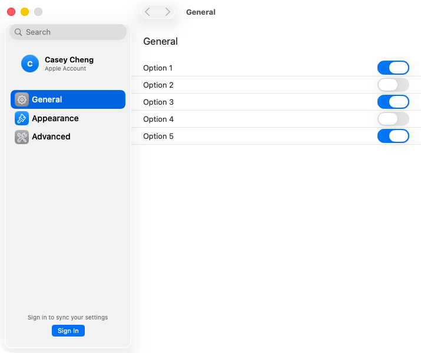
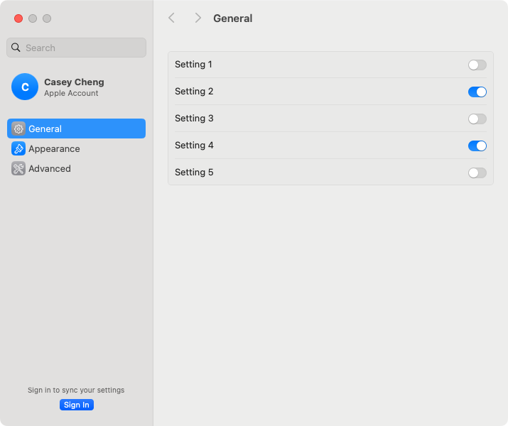

[English](README.md) | 简体中文

# SidebarSettingsKit

给 macOS 上的 SwiftUI 应用做一个系统设置那样的设置窗口：侧边栏里是不折叠的页面列表，上方是搜索框，
旁边是选中的页面，工具栏里放后退和前进。图标可以按系统侧边栏的画法绘制，也可以像系统设置那样放在
彩色方块上。


[](https://github.com/chengzi-io/SidebarSettingsKit/actions/workflows/ci.yml)

<p align="center">
  
</p>
<p align="center"><sub>macOS 27</sub></p>
<p align="center">
  
  
</p>
<p align="center"><sub>左：macOS 26 · 右：macOS 15</sub></p>

## 用 AI agent 添加

```sh
npx skills add chengzi-io/SidebarSettingsKit
```

[skills CLI](https://github.com/vercel-labs/skills) 会把仓库里的 agent skill 装进项目，Claude Code、
Codex、Cursor 以及它认识的其他 agent 都能用；加 `-g` 则装到所有项目。装好之后，让 agent 给应用加上
侧边栏式设置就行：它会读项目、挑好页面和图标、加上依赖、把已有的 `Settings` scene 迁移过来，最后检查
结果。没有这个 CLI 的 agent 也可以直接照着
[`skills/sidebar-settings-kit/SKILL.md`](skills/sidebar-settings-kit/SKILL.md) 做。

## 为什么需要它

| 你想要 | SwiftUI 的 `Settings` scene | SwiftUI 的 `NavigationSplitView` | SidebarSettingsKit |
| --- | --- | --- | --- |
| 工具栏由自己掌控的设置窗口 | 只有偏好设置那套工具栏，没有后退和前进，也放不进你自己的条目 | 普通窗口，⌘, 菜单项得自己加，而且它不是应用的设置窗口 | 一个 `NSWindow`，工具栏由本库填充 |
| 不会跑掉的侧边栏 | 没有侧边栏 | 分隔条往里一拖就折叠，再也没法恢复 | 无法折叠的侧边栏；宽度默认固定，也可以设成在上下限之间拖动调节 |
| 页面之上的搜索框 | 没有 | `.searchable` 会把搜索框塞进工具栏 | 固定在列表上方；⌘F 聚焦，↓ 跳到搜到的页面，Esc 清空 |

## 功能

| 功能 | 默认 | 可以改成 |
| --- | --- | --- |
| 分组的页面侧边栏 | 一个不分组列表 | 用间距隔开的页面分组（`sections:`） |
| 页面之上的搜索框，匹配标题和关键词 | 开启 | 关闭（`.disabled`） |
| 后退和前进，历史记录像浏览器 | 开启：⌘[ 和 ⌘] | 关闭，两个快捷键一并失效 |
| 侧边栏头部（随页面滚动）和底部（固定不动） | 没有 | 任意视图，放在 `header:` 和 `footer:` 里 |
| 图标为纯色，或放在彩色方块上 | 纯色 | 放在方块上，白色符号，没有色调的页面用默认颜色 |
| 侧边栏宽度 | 215 pt，固定 | 任意固定宽度，或可在最小值和最大值之间拖动调节 |
| 窗口 | 715 × 600，固定尺寸，保存位置 | 任意尺寸，可在可选上下限之间缩放，也可以不保存位置 |
| 标题 | 跟随选中的页面 | 一个固定标题，或者工具栏里不显示 |
| 工具栏下方的分隔线 | 跟着系统设置在各 macOS 版本上的样子走（macOS 14 上始终显示） | 没有这个选项 |
| 窗口重新打开时的页面、历史记录和搜索 | 应用运行期间保留 | 每次显示都重置 |
| 本库自带的文字 | macOS 支持的每种语言，按应用的语言显示 | 这五段文字都可以换成你自己的 |

## 快速开始

### 安装

SwiftPM 清单：

```swift
dependencies: [
    .package(url: "https://github.com/chengzi-io/SidebarSettingsKit.git", .upToNextMinor(from: "0.1.0"))
],
targets: [
    .target(
        name: "MyApp",
        dependencies: [
            .product(name: "SidebarSettingsKit", package: "SidebarSettingsKit")
        ]
    )
]
```

本库还在 0.x，次版本发布就可能破坏 API，所以上面写的是 `.upToNextMinor`。

用 Xcode 的话：File > Add Package Dependencies…，粘贴
`https://github.com/chengzi-io/SidebarSettingsKit.git`，版本从 0.1.0 起选 “Up to Next Minor Version”，
再把 `SidebarSettingsKit` 库加到应用 target 上。

### 使用

应用只要三样东西：一个页面类型、一个窗口对象、一个菜单项。代码里的 `ContentView`、`GeneralSettings`
和 `AdvancedSettings` 代表应用自己的视图。

```swift
import SidebarSettingsKit
import SwiftUI

enum Pane: String, CaseIterable, SettingsPage {
    case general, advanced

    var id: Self { self }

    var title: LocalizedStringResource {
        switch self {
        case .general: "General"
        case .advanced: "Advanced"
        }
    }

    var icon: SettingsIcon {
        switch self {
        case .general: .system("gearshape")
        case .advanced: .system("wrench.and.screwdriver")
        }
    }
}

@main
struct MyApp: App {
    private let settings = SidebarSettingsWindow(pages: Pane.allCases) { pane in
        switch pane {
        case .general: GeneralSettings()
        case .advanced: AdvancedSettings()
        }
    }

    var body: some Scene {
        WindowGroup { ContentView() }
            .commands { SidebarSettingsCommands(window: settings) }
    }
}
```

原来的 `Settings` scene 要删掉。`SidebarSettingsCommands` 已经接管它的 Settings… 菜单项和 ⌘, 快捷键，
两边都留着就会出现两个菜单项。

每个页面都写成分组的 `Form`（`.formStyle(.grouped)`），系统设置的页面就是这样。页面自己负责滚动，
窗口不会在外面再套一层滚动视图。既不是表单也不是列表、又可能长得比窗口还高的页面，自己放进
`ScrollView` 里。

scene 的环境传不到这个窗口，页面需要的数据要在 `detail` 闭包里直接交给它。`SettingsLink` 和
`openSettings` 也打不开它，用 `settings.show()` 或者 `SidebarSettingsCommands`。

## 分组、头部和底部

```swift
let settings = SidebarSettingsWindow(
    sections: [
        SettingsPageSection(pages: [Pane.general]),
        SettingsPageSection(pages: [Pane.advanced]),
    ],
    header: { AccountRow() },
    footer: { Text("Version 1.0").font(.caption).foregroundStyle(.secondary).padding(8) }
) { pane in
    switch pane {
    case .general: GeneralSettings()
    case .advanced: AdvancedSettings()
    }
}
```

分组之间只靠间距分开，和系统设置一样；空的分组不显示。头部是列表的第一项，跟着页面一起滚；底部始终
贴在底下。

## 图标

```swift
var configuration = SidebarSettingsConfiguration()
configuration.icons = .tiled

let settings = SidebarSettingsWindow(pages: Pane.allCases, configuration: configuration) { pane in
    switch pane {
    case .general: GeneralSettings()
    case .advanced: AdvancedSettings()
    }
}
```

默认的 `.plain` 按系统侧边栏的画法绘制：图标用自己的色调，在选中行上和标题一起变白。`.tiled` 把它画成
彩色圆角方块上的白色符号，和系统设置一样。方块取页面的色调（`.system("paintpalette", tint: .blue)`）；
页面没有色调时是灰色，除非在 `.tiled(defaultColor: .indigo)` 里另给一个颜色。图标本身就是你自己的视图
（`.custom`）时，两种样式都照原样绘制。

所有图标都填满侧边栏预留的图标槽位，所以和系统设置的图标一样，会跟随用户的侧边栏图标大小设置（16、20
或 24 pt），行高和文字也保持系统原样。两种样式下侧边栏都是系统那个侧边栏列表：选中、方向键、按字选择
（type-to-select）和旁白（VoiceOver）都跟任何 Mac 侧边栏一样好用，macOS 26 及以后还保留 Liquid Glass。

## 配置

```swift
var configuration = SidebarSettingsConfiguration()
configuration.resizing = .resizable(min: CGSize(width: 640, height: 420))
configuration.title = .fixed("Settings")

let settings = SidebarSettingsWindow(pages: Pane.allCases, configuration: configuration) { pane in
    switch pane {
    case .general: GeneralSettings()
    case .advanced: AdvancedSettings()
    }
}
```

| 字段 | 默认 | 其他取值 |
| --- | --- | --- |
| `size` | 715 × 600 | 任意 `CGSize` |
| `resizing` | `.fixed` | `.resizable(min:max:)`，任一边界可以是 `nil` |
| `autosaveName` | `"SidebarSettingsWindow"` | 任意名字；`nil` 表示不保存位置 |
| `sidebarWidth` | `.fixed(215)` | `.adjustable(min:ideal:max:)` |
| `toolbarStyle` | `.automatic` | `.unifiedCompact`（macOS 26 上自动换成 `.automatic`）、`.unified` |
| `showsNavigationButtons` | `true` | `false`，同时去掉 ⌘[ 和 ⌘] |
| `title` | `.followsPage` | `.fixed(_:)`、`.hidden` |
| `search` | `.enabled` | `.disabled` |
| `navigationPersistence` | `.session` | `.resetOnShow` |
| `strings` | `Strings.default` | `Strings(back:forward:searchPrompt:settingsMenuItem:noSearchResults:)` |
| `icons` | `.plain` | `.tiled`、`.tiled(defaultColor:)` |

配置在创建窗口对象时就定下来。最小化和缩放按钮一律置灰，窗口也不能全屏，这是 Apple 对设置窗口的要求，
任何配置都改不了。设成可缩放的窗口照样能从边缘拖动改变大小。

## 浅色与深色

窗口和应用的其他窗口一样跟随应用的外观：默认跟 Mac 的设置，除非应用自己指定。应用里如果给了浅色、深色、
跟随系统三个选项，就通过 AppKit 把它应用到整个应用：

```swift
NSApp.appearance = switch choice {
case .system: nil
case .light: NSAppearance(named: .aqua)
case .dark: NSAppearance(named: .darkAqua)
}
```

SwiftUI 的 `.preferredColorScheme` 管不到设置窗口，在页面里设置也一样。

## 语言

本库自带五段文字：Back、Forward、Search、Settings… 和 No Results（搜索一页都没搜到时侧边栏显示的那句）。
这五句覆盖 macOS 支持的所有语言，措辞直接取自 macOS 在同样控件上的说法，并按应用运行时使用的语言显示，
和 AppKit 显示自己菜单标题的方式一样：

| 应用 | 本库显示的文字 |
| --- | --- |
| 声明了语言（`CFBundleLocalizations`，或者应用包里的 `<language>.lproj` 目录），并在其中一种语言里运行 | 那种语言 |
| 没有声明任何语言（直接 `swift run` 跑出来的可执行文件，或者应用包里没有这一项） | 英文，不管 Mac 用什么语言 |

五句文字每种语言都提供了，但真正显示出来的是应用运行的那种。没有声明语言的应用按英文运行，不管界面是用什么
语言写的。所以一个界面全是日文、bundle 里却没有任何本地化声明（既没有 `CFBundleLocalizations` 项，
也没有 `.lproj` 目录）的应用，在 macOS 看来就是英文应用，本库会在它的日文页面旁边显示英文的 Back、
Forward、Search。这种应用要自己传入文字，下面代码块里的日文就是这么来的。想要别的措辞的应用也一样，
比如把 Settings… 换成 Preferences…：

```swift
configuration.strings = .init(
    back: "戻る", forward: "進む", searchPrompt: "検索", settingsMenuItem: "設定…",
    noSearchResults: "結果なし")
```

以 key 形式给出的文字，和应用的其他文字一样跟着应用的语言走，从存着这个 key 的 string catalog 里取。
没写 bundle 的 key 会去应用的主 bundle 里找，应用 target 的 catalog 就在那里。Swift package 模块的
资源放在它自己的 bundle 里，所以来自模块 catalog 的 key 必须写明取哪个 bundle，否则会找不到这个 key，
显示的是它的默认值：

```swift
configuration.strings = .init(
    back: LocalizedStringResource("Back", bundle: .atURL(Bundle.module.bundleURL)))
```

窗口只在构建时读一次语言。在系统设置里改应用的语言会让应用重启，所以一切都跟着变。不重启就切语言的
应用（用 `.environment(\.locale, …)`）只能影响到页面，而且还得把 locale 应用在 `detail` 里：侧边栏的
标题、窗口标题和本库自带的文字都会停在启动时的语言，直到应用重启。

## 打开到某一页

```swift
@MainActor
func openAdvanced(_ settings: SidebarSettingsWindow<Pane>) {
    settings.show(page: .advanced)
}
```

`show(page:)` 会激活应用并把窗口提到前面，菜单栏应用正需要这一步。

## 菜单栏应用

```swift
struct MenuBarSettingsApp: App {
    private let settings = SidebarSettingsWindow(pages: Pane.allCases) { pane in
        switch pane {
        case .general: GeneralSettings()
        case .advanced: AdvancedSettings()
        }
    }

    var body: some Scene {
        MenuBarExtra("MyApp", systemImage: "bolt") {
            OpenSidebarSettingsButton(window: settings)
            Button("Quit MyApp") { NSApp.terminate(nil) }
        }
    }
}
```

`OpenSidebarSettingsButton` 可以在任意一页打开窗口，菜单项的措辞用本库自带的 Settings…，也可以自己给。
只为凑一个 scene 才留着的 `Settings` scene 现在可以删了：`MenuBarExtra` 自己就是一个 scene。

## 环境要求

| | |
| --- | --- |
| 运行使用本库的应用 | macOS 14 或更高；macOS 14 没有测过，CI 和人工都没有 |
| 构建 | Xcode 26 或更高，Swift 6.2 或更高（清单是 `swift-tools-version: 6.2`） |
| 依赖 | 无 |

## 已知限制

[docs/zh/ROADMAP.md](docs/zh/ROADMAP.md) 列出了本库目前的限制，以及计划中的工作。

## 文档

| 文件 | 内容 |
| --- | --- |
| [docs/zh/ARCHITECTURE.md](docs/zh/ARCHITECTURE.md) | 窗口是怎么搭起来的，每一部分为什么是现在这样 |
| [docs/zh/DEVELOPMENT.md](docs/zh/DEVELOPMENT.md) | 演示应用、截图、CI、发布 |
| [docs/zh/TESTING.md](docs/zh/TESTING.md) | 测试 target、fixtures、窗口测试和“假通过”规则 |
| [docs/zh/MANUAL-QA.md](docs/zh/MANUAL-QA.md) | 维护者发布前要做的检查 |
| [docs/zh/ROADMAP.md](docs/zh/ROADMAP.md) | 计划中的工作和已知限制 |
| [CHANGELOG.md](CHANGELOG.md) | 每个版本的变化 |

## 参与贡献

日常开发看 [docs/zh/DEVELOPMENT.md](docs/zh/DEVELOPMENT.md)，发布前的检查看
[docs/zh/MANUAL-QA.md](docs/zh/MANUAL-QA.md)。`make ci` 通过之后，pull request 才算准备好。

## 许可证

MIT。见 [LICENSE](LICENSE)。
